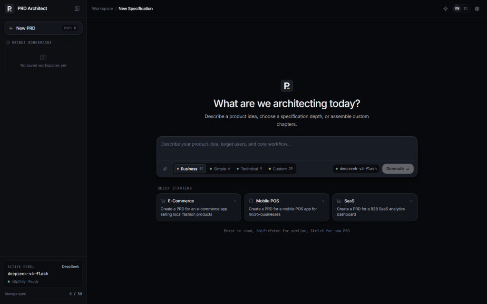
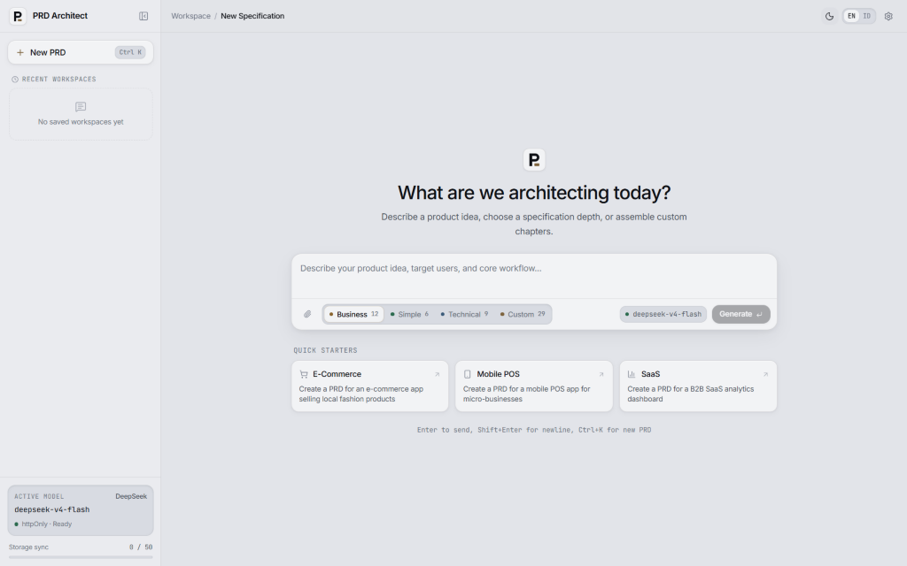
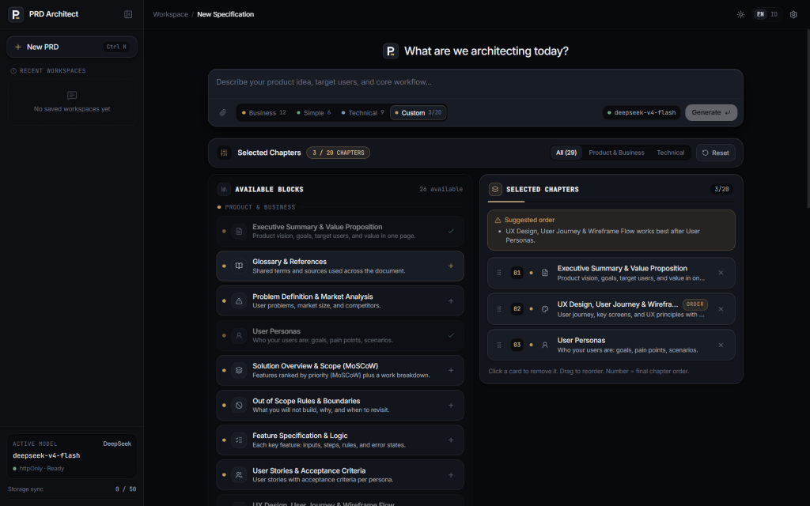
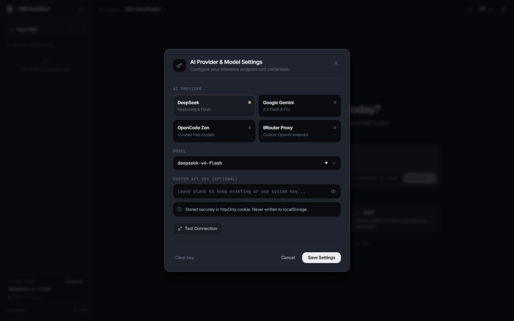

<div align="center">
  
  <h1 align="center">PRD Architect</h1>

  <p align="center">
    <strong>An intelligent, AI-powered architectural workbench for creating comprehensive Product Requirements Documents.</strong>
    <br />
    <br />
    <a href="#overview">Explore Features</a>
    ·
    <a href="#screenshots">Screenshots</a>
    ·
    <a href="https://prd-architect.onrender.com/">Live Demo</a>
    ·
    <a href="#getting-started">Get Started</a>
    ·
    <a href="#configuration">Configuration</a>
  </p>

  <p align="center">
    
    
    
    
    
  </p>
</div>

---

## Overview

**PRD Architect** is a full-stack application designed to accelerate product planning from raw idea to structured specification. Given a product idea and optional reference files, it streams a structured Product Requirements Document (PRD), Technical Specification, MVP Brief, or Custom Blueprint with live Mermaid diagrams, an interactive WBS Canvas, version history, and multi-format exports.

It supports **four generation modes**:

- **Simple PRD Mode (6 Chapters)**: Designed for early-stage MVPs and solo builders. Covers Problem Statement, Feature Scope (MoSCoW), Out of Scope Rules & Boundaries, User Stories & Core Workflows, detailed Feature Specifications (input fields, business logic, error states, integrations), and Open Questions with Success Metrics & Timeline.
- **Business & Investor Mode (12 Chapters)**: Covers Stakeholder Analysis, Problem Statement, Assumptions & Constraints, Non-Goals, TAM/SAM/SOM, MoSCoW scoping, Enhanced User Stories (Given/When/Then + Epic hierarchy), Classified NFRs (Performance, Scalability, Security, Usability, Availability), Baseline-backed KPIs, GTM Strategy, Risk Register with scoring, 12-week roadmap, and Regulatory Compliance.
- **Technical & AI Agent Mode (9 Chapters)**: Covers System Context Diagram, Alternatives Considered, Non-Goals, Data Models with ERD, API Contracts with full Error Responses (`400`/`401`/`403`/`404`/`409`/`500`), Frontend Architecture with Data Flow Diagrams, Testing Pyramid Strategy, Classified NFRs, Retry Strategy with exponential backoff, and AI Agent Implementation Guidelines.
- **Custom PRD Builder (Up to 20 Chapters from 29 Modular Blocks)**: Assemble a tailored document outline from 29 curated blocks across **Product & Business** and **Technical** categories, reorder selected chapters via drag-and-drop, and review live dependency-order suggestions before generation.

## Screenshots

### Dual-Mode Workspace (Obsidian Hero & Anti-Glare Titanium)

| Dark Mode (Obsidian Hero) | Light Mode (Anti-Glare Titanium) |
| :---: | :---: |
|  |  |

### Custom PRD Workbench (29 Modular Blocks & Order Validation)



### AI Provider & Model Settings (BYOM & httpOnly Key Storage)



## Features

- **Four-Mode Generation Engine**: Switch cleanly between Simple (6 chapters), Business & Investor (12 chapters), Technical & AI Agent (9 chapters), and Custom PRD Builder (up to 20 chapters chosen from 29 modular blocks with drag-and-drop ordering).
- **Obsidian Atelier Dual-Mode UI**: Focused, low-glare interface offering **Dark (Obsidian Hero)** and **Light (Anti-Glare Titanium, capped at matte `#F2F3F5` surfaces)** modes, self-hosted Inter and JetBrains Mono typography, and `motion` transitions that respect `prefers-reduced-motion`.
- **Collapsible Sidebar & Live Chapter Outline**: Spring-animated navigation rail with live chapter tracking, streaming chapter pulse indicators, per-chapter comment badges, and version history switching.
- **Bring Your Own Model (BYOM)**: Switch between **DeepSeek** (`deepseek-v4-flash`, `deepseek-v4-pro`), **Google Gemini** (`gemini-2.5-flash`, `gemini-2.5-pro`), **OpenCode Zen** (5 free models: `deepseek-v4-flash-free`, `nemotron-3-ultra-free`, `mimo-v2.5-free`, `north-mini-code-free`, `big-pickle`), and **9Router / Custom OpenAI-Compatible Proxy**, complete with live connection testing.
- **Real-Time SSE Streaming, Auto-Continue & Reasoning Drawer**: Abortable, timeout-free SSE streaming suited for deep-reasoning models, with automatic multi-call continuation, SSE heartbeats, structural mid-output truncation detection, continuation seam repair, a one-click `Continue` fallback if a stream stops early, and a collapsible `ReasoningPanel` displaying live elapsed thinking time and stream progress.
- **Dual-Theme Live Mermaid Diagrams**: Renders System Context (`graph`), Entity Relationships (`erDiagram` with automatic relationship-label and identifier sanitization), User Journeys (`journey`), Roadmaps (`gantt`), and Sequence Flows (`sequenceDiagram`) with automatic syntax sanitization, Dark/Light theme adaptation, and a toolbar for `Source`, `Copy`, and full-screen `Zoom`.
- **Inline Chapter Notes, Sticky Revision CTA, Smart Revision Dock & Version Diff**: Attach targeted notes from any sticky chapter header (`Add note`), top inline editor, or sidebar quick-note entry, trigger multi-chapter revisions from the floating `SmartRevisionDock`, and inspect line-level diffs across versions.
- **Interactive WBS Canvas**: Visualize any generated PRD as a React Flow Work Breakdown Structure parsed straight from markdown, with MoSCoW priority badges, ancestor-to-descendant path highlighting, and a slide-in `DetailPanel`.
- **Reference File Context Upload**: Upload PDF, DOCX, XLSX, CSV, text/Markdown, and image files to ground generation in existing specifications and notes.
- **Multi-Tab Local Persistence**: Autosaves versions and drafts to IndexedDB with `BroadcastChannel` cross-tab synchronization, schema validation, and storage quota alerts.
- **Bilingual Support (EN / ID)**: Full interface copy, system prompts, and quick-prompt starters available in both English and Indonesian.
- **Editorial Print Export Suite**: Copy Markdown to clipboard, export to Markdown (`.md`), Editorial Print Word (`.docx` with cover metadata, rasterized light-theme Mermaid diagrams, and native rowspan WBS tables), Editorial Print PDF (`.pdf` with embedded Unicode Inter and JetBrains Mono TTF fonts, FlateDecode stream and image compression, cover page, running headers/footers, dynamic column weighting, and smart page-break/orphan guards), structured JSON (`.json`), or print via a theme-independent paper layout, all using clean derived product filenames (`PRD_<ProductName>_*`).

## WBS Canvas

Once a PRD has been generated, switch from **Document** to **WBS Canvas** in the header. The canvas parses the PRD markdown into an interactive Work Breakdown Structure tree showing modules, features, and sub-features color-coded by MoSCoW priority.

**Interactions:**

- **Zoom, Pan & Floating Toolbar**: Use the mouse wheel to zoom and drag to pan, navigate with the minimap, or use the floating bottom-left toolbar for zoom (`-` / `%` / `+`), `Fit view`, `Collapse all / Expand all`, and live node count. Zoom is clamped (`0.3` minimum, `1.2` max initial fit) so layouts stay readable.
- **Expandable Hierarchy**: The canvas opens expanded so the full breakdown is immediately scannable. Click the **chevron** on any parent node to collapse or expand its subtree (collapsed nodes display a `+N` badge), or toggle all modules at once from the toolbar.
- **Path Highlighting & Slide-In Detail Panel**: Click (or press `Enter`/`Space` on) a node to highlight its ancestor-to-descendant path in Satin Champagne and open a `380px` spring slide-in `DetailPanel` with the node's breadcrumb, MoSCoW priority badge, clean per-feature detail snippet, sub-items, and quick `Open Document` / `Add note` actions.
- **Close the detail panel**: Click the backdrop, click the close button, or press `Esc`.

**Parsing:** features are extracted automatically from the PRD markdown in priority order:

- **`### Feature Breakdown (WBS)` section**: hierarchical modules, features, and sub-features (all modes), merged with MoSCoW priorities via title matching.
- **MoSCoW tables**: priority/feature source (business & technical modes).
- **`### FEAT-XX` spec blocks**: features with feature codes (simple mode fallback).
- **Any `###` heading**: last-resort fallback.

Parse quality depends on how closely the model follows the formatting contract enforced in `server/prompts.ts` and `server/blockPrompts.ts`. When a source is missing or malformed, the canvas displays an info banner with warnings instead of failing.

**Limitations:**

- **Read-only layout**: Node positions are computed deterministically per render and are **not** persisted across re-renders.
- Parsing is heuristic and tolerant: non-conforming markdown degrades gracefully to fallback strategies with warnings.

## Tech Stack

- **Frontend**: React 19, Vite, Tailwind CSS v4, `motion`, `@dnd-kit`, `@xyflow/react`, Lucide React, React Markdown (`remark-gfm`), Mermaid.js, self-hosted Inter & JetBrains Mono (`@fontsource`)
- **Export & Diff**: `docx`, `jspdf`, `jspdf-autotable`, `diff`
- **Persistence**: IndexedDB (`idb-keyval`) + `BroadcastChannel`
- **Backend**: Node.js 22 (pinned in `.node-version`; `engines.node >= 18`), Express.js, Helmet, CORS, `express-rate-limit`, `cookie-parser`, Multer, `pdf-parse`, `mammoth`, `exceljs`
- **Tooling & Testing**: TypeScript, esbuild, Vitest (`jsdom` + v8 coverage)
- **AI Integration**: Native Fetch API for OpenAI-compatible SSE streaming across **DeepSeek**, **Google Gemini**, **OpenCode Zen**, and **9Router / Custom Proxy**

## Getting Started

### Prerequisites

- Node.js 22 recommended (v18 or higher supported)
- npm or pnpm
- API key from your preferred AI provider (DeepSeek, Google Gemini, 9Router, or OpenCode Zen free models)

### Installation

1. **Clone the repository**

   ```bash
   git clone https://github.com/TrygerZ/PRD-Architect.git
   cd PRD-Architect
   ```

2. **Install dependencies**

   ```bash
   npm install
   ```

### Configuration

You can configure the AI provider, model, and custom endpoint directly from the **Settings** modal in the app. Supported providers include **DeepSeek**, **Google Gemini**, **OpenCode Zen** (5 free models), and **9Router Proxy** (custom OpenAI-compatible URL and model name).

#### API Key Setup

Provide your API keys through one of two methods:

**Method A: Environment Variables (`.env`)** *(Recommended for local dev)*

Copy `.env.example` to `.env` in the project root:

```env
DEEPSEEK_API_KEY=your_deepseek_key
GEMINI_API_KEY=your_gemini_key
OPENCODE_API_KEY=your_opencode_key
NINE_ROUTER_API_KEY=your_9router_key

# Keep false on public instances; set true only on trusted private/local installs
# that intentionally share server-side API keys when clients omit their own key.
ALLOW_SERVER_KEY_FALLBACK=false

# Required in production (comma-separated origins for CORS)
ALLOWED_ORIGINS=https://prd-architect.example.com
```

**Method B: In-App UI**

Open **Settings** inside the app and paste your API key. The backend stores it in a secure `httpOnly` cookie for subsequent API requests, and you can verify connectivity immediately with **Test Connection**.

### Running the App

Start the development server:

```bash
npm run dev
```

The application will be available at [http://localhost:3000](http://localhost:3000).

### Verification & Tests

Run typechecking and the unit test suite:

```bash
npm run typecheck
npm test
npm run test:coverage
```

## Building for Production

Create a production build spanning the React SPA and Express backend:

```bash
npm run build
npm run start
```

The server binds to `0.0.0.0:3000` (or `PORT`) and serves the optimized static frontend alongside the API.

## License

This project is licensed under the [MIT License](LICENSE).
